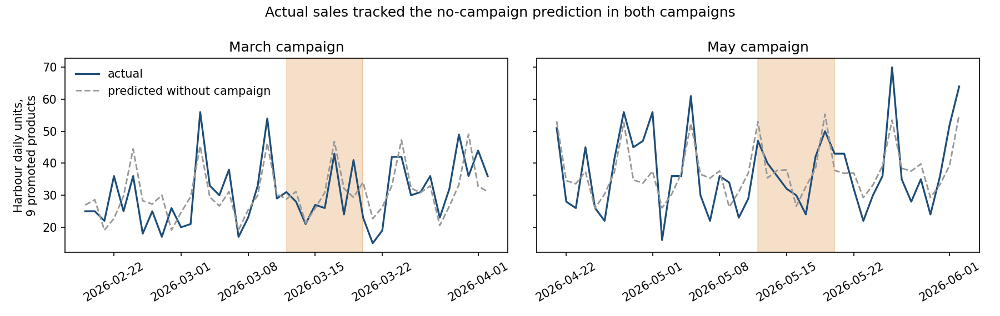

# Step 2: Did Harbour's 15% campaigns pay for themselves — and how sure can we be?

## Conclusion

Harbour ran two 8-day campaigns (12–19 March and 12–19 May 2026) with 15% off 9 cold-coffee and dessert items, giving away **$472** in discounts (measured). To judge them, we estimated what Harbour would have sold without the campaign. We compared four predictors on 130 ordinary 8-day periods they were not trained on. A **linear regression** using weekday, trend and same-day Garden + Uptown sales was the most accurate; gradient boosting was 21–29% *less* accurate, so we did not use it. The estimated extra promoted-item sales were **−5 units in March and −16 in May**. Their chance ranges reach at most **+34 and +24**, against a break-even of **+72 and +93**. Both campaigns fall short separately, and the shortfall holds even if Harbour's true costs were half of those recorded. Estimated effect on Harbour's total gross profit: **−$308 (March), −$391 (May)**. There is no rebound the following week. **Recommendation:** do not repeat the campaign unchanged. If Stories wants these discounts, run them as a randomized test with gross profit as the main outcome. A 6-week test (about 21 offer and 21 no-offer days) can detect a +15% lift.

## Which predictor? (tested on 130 hidden 8-day ordinary periods)

| Method | Mean 8-day error: promoted units | Mean 8-day error: Harbour gross profit |
|---|---:|---:|
| Same-weekday average | 25.4 | $294 (biased by growth) |
| Branch ratio | 25.8 | $269 |
| **Linear regression** | **19.5** | **$174** |
| Gradient boosting (ML) | 24.6 | $225 |

These hidden periods also serve as **fake campaign dates**: their errors show how large an "effect" chance alone produces.

## Campaign estimates (linear regression)

| | March | May |
|---|---:|---:|
| Discount given (measured) | $210 | $262 |
| Extra promoted units (chance range) | −5 (−41 to +34) | −16 (−51 to +24) |
| Break-even extra units at recorded costs / at half costs | +72 / +54 | +93 / +70 |
| Extra other-item units | −19 | −23 |
| Harbour gross profit effect (chance range) | −$308 (−$662 to +$12) | −$391 (−$745 to −$71) |

All four methods agree on direction: none finds a promoted-unit lift above +21 in either campaign.

## Measured vs. estimated vs. assumed

- **Measured:**
  - Campaign dates, items and branch, and the $472 of discount.
  - Each predictor's accuracy on hidden periods.
- **Estimated:** the effects and break-even levels above.
- **Assumed:**
  - Harbour's relationship to weekday, trend and the other branches would have continued without the campaign.
  - No customers switched branches because of the campaign. If some did, the estimate is *too favourable* to the campaign.
- **Not observed:** the campaign's goal, advertising cost and waste avoided. Waste avoided is the main benefit that could still justify a redesigned campaign.

Only two campaigns at one branch were observed. The data rules out a lift large enough to break even, but cannot measure small effects precisely.

Full analysis: [`notebooks/02_promo_campaign.ipynb`](../notebooks/02_promo_campaign.ipynb).
