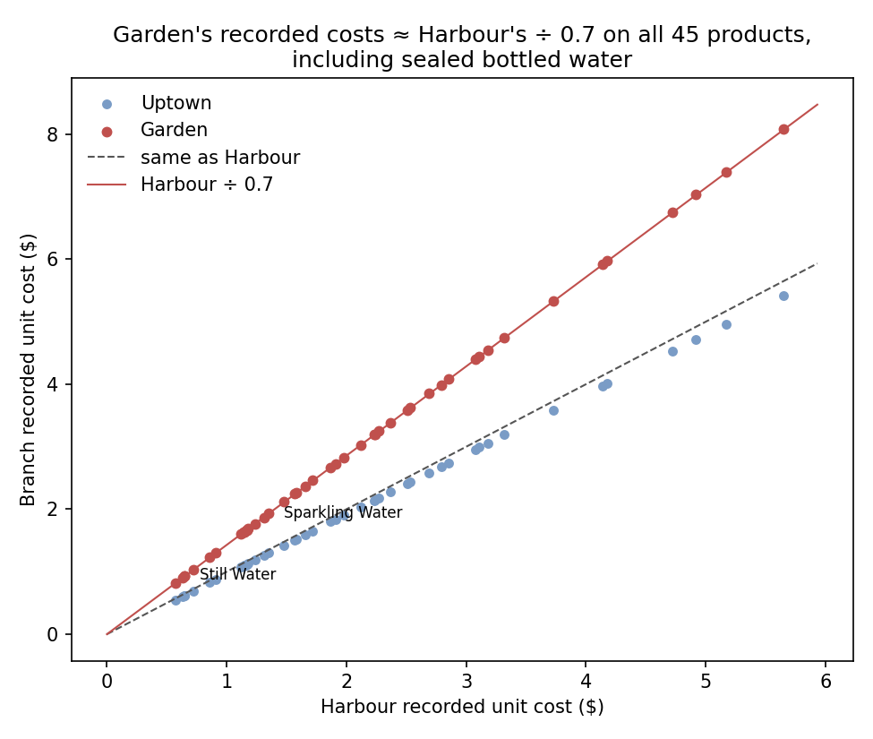

# Step 3: Garden's margin depends on one costing assumption

## Conclusion

Garden's reported gross margin is 46.9%, against 65.0% at Harbour and 62.6% at Uptown. Across all 45 products, Garden's recorded unit costs are about **43% higher than Harbour's**: each equals Harbour's ÷ 0.7 within one cent of rounding, including sealed bottled water. Recorded costs never change over the six months. If Garden's actual quantities, prices and discounts are kept and only its unit costs are replaced with Harbour's, its six-month gross profit rises by **$15,923** and its margin becomes **62.9%**, assuming Harbour's costs are the right benchmark. Removing repeated rows gives the same picture ($15,888; 46.9% → 62.9%). The reported margin gap is therefore **largely explained by recorded unit costs; it does not establish poor branch management**. The near-uniform multiplier suggests a **systematic costing or pricing rule that should be audited**. Possible explanations include supplier pricing, allocated overhead, internal transfer pricing or a configuration error, and this dataset cannot tell which. **Recommendation:** before any margin-based decision about Garden (menu cuts, a +16% price rise, management changes), compare invoices and the recorded costing rules for water and a few representative products at Garden and Harbour. The value at stake is about **$32,100 a year** (observed period annualised), or about $38,700 if June's volume persists. That is cash only if Garden really pays more *and* equivalent supply terms, logistics and quality are feasible for Garden; otherwise the value is avoiding a wrong decision about the second-largest branch.

## Centrepiece: Garden's margin under different cost assumptions (scenarios)

| Costs used for Garden (sales unchanged) | Garden gross profit, H1 | Margin |
|---|---:|---:|
| Recorded costs (as reported) | $46,795 | 46.9% |
| Half of the gap is real | $54,756 | 54.9% |
| Harbour's unit costs | $62,718 | 62.9% |
| Uptown's unit costs | $64,204 | 64.4% |

## What the data can and cannot say

| Explanation | Assessment |
|---|---|
| Waste, theft or portions, measured product by product | Unlikely to be directly reflected: an identical ×1.43 on sealed bottles. But waste spread evenly into standard costs cannot be excluded |
| Volume terms (small branch pays more) | Weakened: Uptown is the smallest branch and has the lowest costs. Other supplier-contract explanations remain possible |
| Different product mix | Not supported: the gap holds within every product |
| Supplier pricing, allocated overhead, transfer pricing, configuration error | All consistent with the data; an audit is needed to tell them apart |

## Measured vs. estimated vs. assumed

- **Measured:**
  - The ÷0.7 pattern; costs and prices fixed for 181 days.
  - The $15,923 recorded-cost difference; the monthly gap grew from $2,154 to $3,224.
- **Scenarios:**
  - The margins in the table above.
  - About $32,100 a year (×365/181), or about $38,700 at June's rate.
  - Matching Harbour's prices would recover only about $5k (31%) if volume held.
- **Assumed:** the cost field reflects a real Stories costing rule, not an export artefact.
- **Not in the data:** invoices, contracts, overhead or transfer-pricing policy, how the cost field is filled in, waste.

## Side note: the 10% discount

$1,707 in six months (0.56% of revenue). It is broadly dispersed across branches, hours, categories and customers. The data cannot show whether it changes what customers buy, so we draw no causal conclusion. Recording a reason code at the till for each 10% discount is a cheap way to make it measurable.

Full analysis: [`notebooks/03_garden_costs.ipynb`](../notebooks/03_garden_costs.ipynb).
