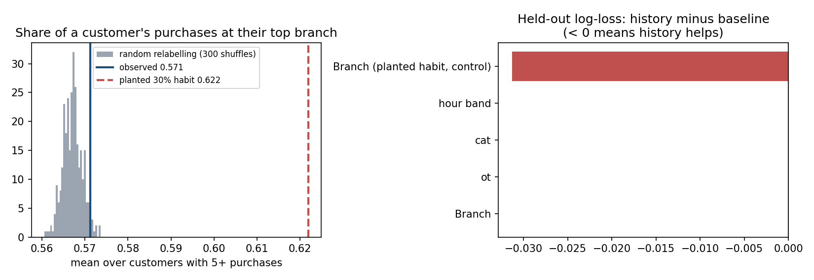

# Step 4: Should Stories invest in personalised marketing based on customer history?

## Conclusion

**Selecting customers by Q1 spending showed no demonstrated advantage over random selection for Q2 gross profit. Validate customer-history targeting before committing marketing budget.**

This is a supporting finding. It has no dollar value attached; its value is avoiding a marketing investment whose key assumption (that purchase history helps select and predict customers) has not been demonstrated in this data. Evidence: [notebook 04](../notebooks/04_personalised_marketing.ipynb).

## Targeting test (the decision test)

* **Eligibility:** only customers with at least one identified purchase in Q1 (3,255 of 3,494). A marketer at the end of March could not select anyone else. The same eligible pool is used for both the targeted and the random selections. Eligible customers with no Q2 purchase (112) count as $0 in Q2.
* **Method:** rank eligible customers by Q1 (Jan–Mar) gross profit and select the top 10%, 20% or 30%. Measure the Q2 (Apr–Jun) gross profit **subsequently observed** from them, and compare with 5,000 random selections of the same size.
* **What it is not:** this is observed gross profit from selected customers. It is **not** profit caused by a marketing campaign, and not money gained or lost.

| Selected (three cut-offs tested) | Q2 GP of selected (Fact) | Random selections: mean (Estimate) | Random 95% range | Random selections that did at least as well |
|---|---:|---:|---|---:|
| Top 10% by Q1 GP (325) | $5,674 | $5,992 | $5,626–$6,359 | 95% |
| Top 20% by Q1 GP (651) | $11,410 | $12,008 | $11,497–$12,512 | 99% |
| Top 30% by Q1 GP (976) | $17,487 | $17,997 | $17,448–$18,573 | 96% |

At no cut-off did selection by Q1 spending beat random selection. At 10% and 30% it is inside the random range, near its lower end; at 20% it is slightly below (about 5% under the random mean). We do **not** claim that targeting performs worse: the shortfall is small, it comes from one Q1→Q2 split, the three cut-offs overlap (the top 10% is inside the top 20%), and the test was not fixed in advance.

## Supporting tests (Estimates: depend on a simulation or model)

| Test | Observed | Comparison | Reading |
|---|---|---|---|
| Held-out next purchase: last purchase of 2,557 customers; smoothing chosen on a separate validation purchase | Log-loss difference (history − baseline) = **0.000** for branch, order type, category and time band; accuracy unchanged | No-history baseline (overall mix) | No demonstrated predictive lift. **Sign:** negative = history predicts better |
| Positive control: same held-out test after planting a 30% home-branch habit | Log-loss difference **−0.031** (95% range −0.043 to −0.020); accuracy 0.502 → 0.524 | Same baseline | The method **does** detect a modest habit when one exists |
| Customers at all three branches | 1,952 of 3,494 (56%) | Random relabelling: 1,979 (1,940–2,023) | About what random relabelling gives; not evidence of customers moving between branches |
| Share of a customer's purchases at their top branch (5+ purchases) | 0.571 | Random relabelling: 0.567 (0.563–0.571); planted 30% habit: 0.622 | At the edge of the random range (p ≈ 0.04, one of five tests); far below the planted habit |
| Same for order type / first-item category | 0.672 / 0.355 | 0.671 / 0.358 | No detected habit |
| Spread of purchase hour (sd) | 4.46 h | 4.46 h | No detected time-of-day habit |

## Measured facts

| Fact | Value |
|---|---|
| Identified purchases | 21,534 of 33,887 (63.5%); $194,203 of $305,925 revenue (63%) |
| Purchases per customer | mean 6.16, variance 6.09 (variance/mean 0.99), max 18 |
| Missing-ID rate | 36–37% at every branch and for both order types |

## Alternative explanations

| Explanation | Assessment |
|---|---|
| Customers really roam between nearby branches | Does not explain the lack of time, order-type or product habits |
| A few shared staff/"house" cards | Not supported: max 18 purchases per ID, variance/mean ≈ 1 |
| Missingness biases the picture | Not supported as the main cause: missing rate equal by branch and order type |
| IDs recycled or re-issued | Possible, not tested separately |
| IDs attached without regard to the person (POS, export process, or the way this dataset was produced) | Consistent with all tests, but a **hypothesis**: the data cannot identify the mechanism |

**What we do not claim.** We do not claim that `Customer ID` is random, redundant or useless, or that the data is synthetic. We claim that the usefulness of customer history for customer-level decisions **has not been demonstrated** in this export.

## Assumptions and weak areas

* Real café customers would usually show at least a modest branch, time or product habit, and spend that persists between quarters. This is general retail knowledge, not measured here; the positive control shows only that the tests could detect such a habit.
* The 30% planted habit is our choice of a "modest" effect.
* Q1→Q2 gross profit stands in for "customer value". A real campaign would also depend on response to the offer, which this data cannot show.
* One time split; three overlapping cut-offs; the test was not fixed in advance.

## Rejected approaches

* **Customer segmentation (RFM, k-means):** segments can always be produced, but the tests above find no stable signal for them to describe.
* **Gradient-boosted next-purchase model:** the simple smoothed-history model already shows no lift over the baseline; a more flexible model would fit noise more confidently.

## Practical test

1. **1-day POS audit:** how is `Customer ID` attached to a purchase (loyalty scan, phone number, cashier default)?
2. **4-week verified-ID pilot at one branch:** re-run the targeting and held-out tests on pilot data.
3. **Pass criterion, fixed in advance:** history-based selection above the random-selection 95% range *and* a held-out log-loss difference whose 95% range is entirely below zero. Only then commit marketing budget to history-based targeting.
