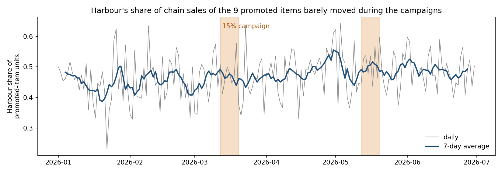

# Step 2: Did Harbour's 15% campaign pay for itself?

## Conclusion

Harbour ran two 8-day campaigns (12–19 March and 12–19 May 2026) giving 15% off 9 cold-coffee and dessert items. They gave away **$472** in discounts and produced no measurable extra business. Sales of the promoted items rose by an estimated **+11 units (+2%)**, which is inside the range that ordinary days produce by chance. Breaking even needed about **+159 units (+30%)**, more than even a generous upper bound (+125). Purchases and other items did not rise, the following week showed no rebound, and **93%** of identified campaign buyers were already customers. **Recommendation:** stop repeating this untargeted campaign design. Test any future discount with randomized offer days first; a 6-week test (about 20 offer and 20 control days) can detect a +30% lift. The only thing that could reverse this is a benefit missing from the data, mainly waste avoided on desserts, worth roughly $100–$440 over the 16 days.

## Evidence at a glance

| Metric (16 campaign days) | Actual | Expected without campaign | Estimated effect | Chance range (placebo 5th–95th pct) |
|---|---:|---:|---:|---:|
| Promoted-item units | 542 | 531 | +11 | −90 to +114 |
| Other-item units | 1,862 | 1,929 | −67 | −220 to +191 |
| Purchases | 1,499 | 1,529 | −29 | −141 to +131 |
| Promoted-item gross profit | $1,610 | $2,029 | −$419 | −$354 to +$434 |
| All Harbour gross profit | $8,632 | $9,154 | −$521 | −$985 to +$1,039 |

Method: each campaign day's Harbour sales are predicted from Garden + Uptown on the same day, using Harbour's usual same-weekday ratio within ±28 days. The chance range comes from applying the identical method to 130 non-campaign 8-day windows. Removing exact repeated rows changes every effect by less than $15.

## Measured vs. estimated vs. assumed

- **Measured:** the 15% rate was used only at Harbour, only on those 9 items and 16 days, and on every such sale. The discount totalled $472 on 542 units.
- **Estimated:** volume lift, break-even volume and gross-profit effect (table above).
- **Assumed:**
  - Without the campaign, Harbour's ratio to the other branches would have stayed normal.
  - The campaign did not change Garden/Uptown sales. If it did, the chain-wide result is *worse*.
  - Recorded unit costs are correct.
- **Not in the data:** the campaign's goal, advertising cost, waste avoided and long-term customer effects.

Full analysis, rejected approaches and limitations: [`notebooks/02_promo_campaign.ipynb`](../notebooks/02_promo_campaign.ipynb).
